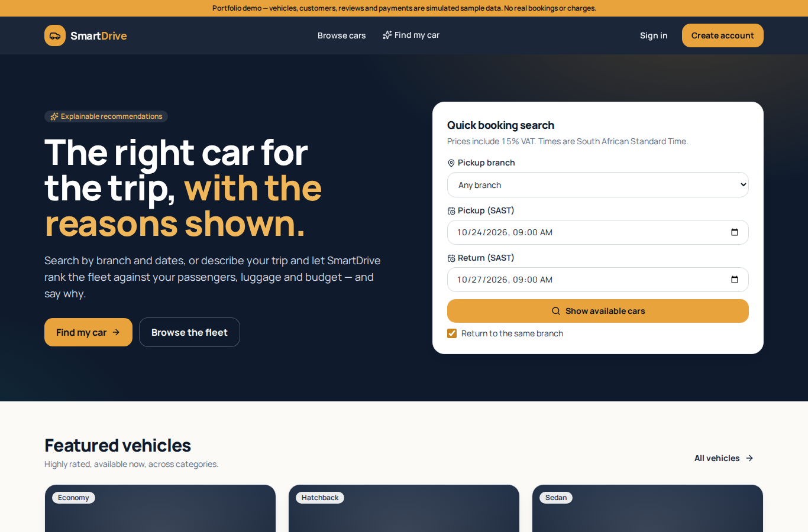
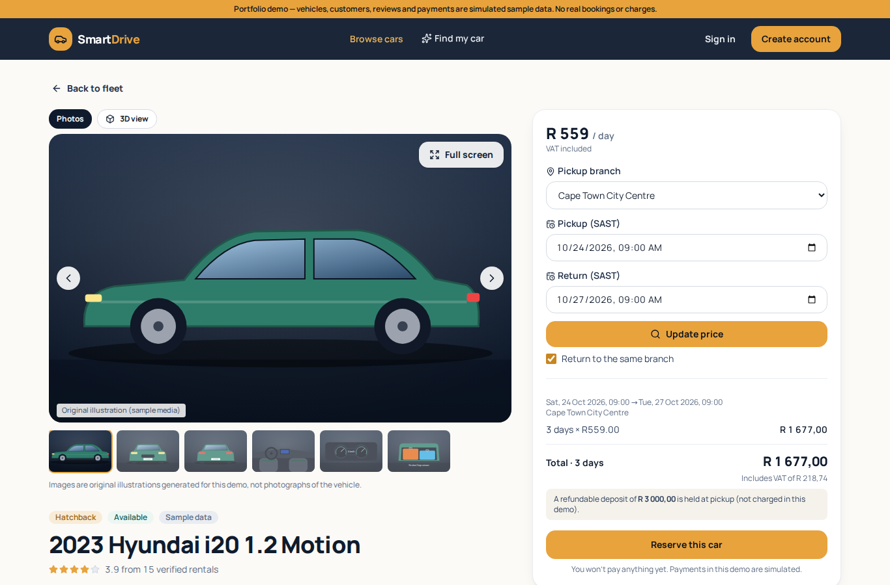
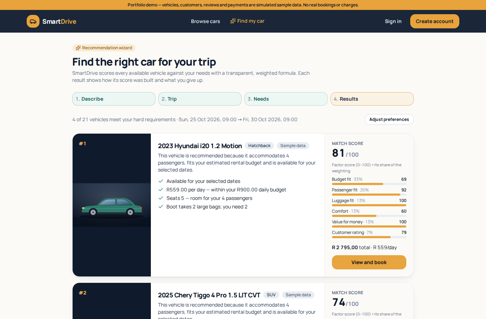
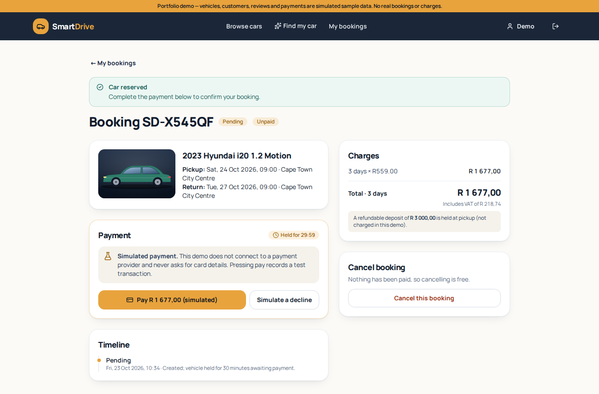
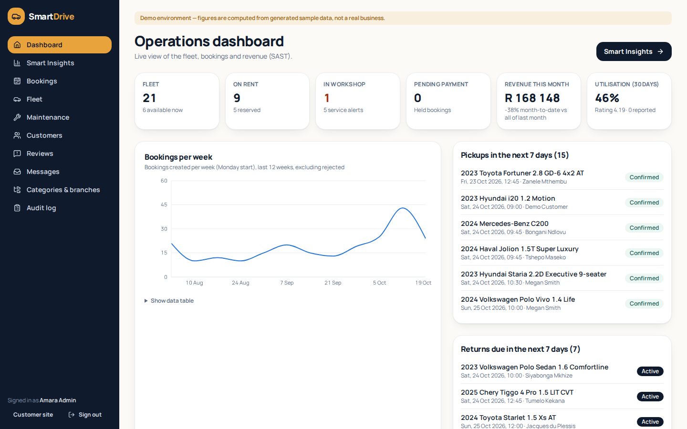
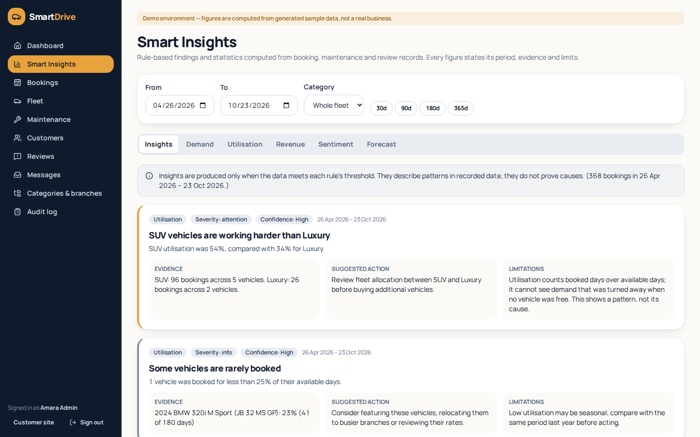
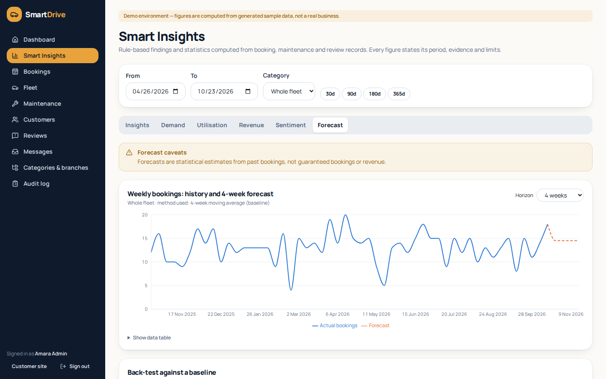
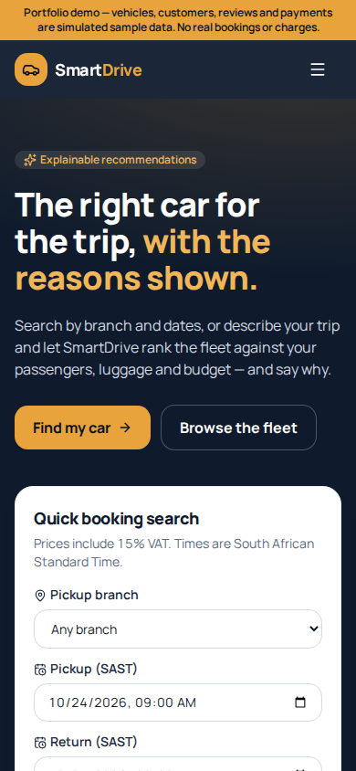

# SmartDrive — AI-assisted car rental management

SmartDrive is a full-stack car-rental system for a South African rental business: a customer site for finding and booking cars, and an admin dashboard for running the fleet. It is a ground-up rebuild of a car-rental program I first wrote in Java for my matric project, redesigned with a layered ASP.NET Core API, a React front end, real concurrency control and explainable analytics.

> **Portfolio demo.** All vehicles, customers, bookings, reviews and payments are generated sample data and are labelled as such in the UI and database. Payments are simulated — no payment provider is connected and no card details are ever requested. Vehicle images are original illustrations, not photographs.

## What it does

**Customers**
- Search by branch and date range (South African Standard Time) and see only cars that are genuinely free — availability accounts for confirmed bookings, a 2-hour turnaround between rentals, unpaid 30-minute holds and workshop time.
- Filter and sort the fleet; view a vehicle's gallery full-screen or in an optional, lazily loaded 3D view (a clearly labelled generic demo shape unless a licensed model is attached).
- Get server-calculated quotes in Rand, VAT included, itemised: per started 24 hours with a 59-minute grace period, 10% off from 7 days, 15% off from 21 days, and an R850 one-way fee between cities.
- Book with protection against double booking, pay through a simulated, idempotent payment step, cancel under a clear policy (free until 48 hours before pickup, then one day's rental), and review completed rentals.
- Use the **recommendation wizard**: describe a trip in plain English or fill in a form, and get ranked cars with the score breakdown, reasons and trade-offs for each.

**Administrators**
- Operations dashboard: fleet state, pickups and returns due, pending payments, revenue and utilisation.
- Fleet management with image upload (content-sniffed, size-limited), status changes and archiving; maintenance scheduling with service-due and repeated-issue alerts.
- Booking lifecycle management through an enforced state machine, with odometer capture and automatic excess-mileage charges.
- Customer accounts and roles (deactivation takes effect immediately, even for issued tokens), review moderation, contact messages and an audit log.
- **Smart Insights**: demand, utilisation, revenue, review sentiment, a weekly demand forecast that is back-tested against a simple baseline, and rule-based findings — each with its period, evidence, confidence and limitations. CSV export throughout.

## How the "AI" works — and what it is not

SmartDrive uses transparent, testable techniques rather than opaque models:

| Feature | Technique | Details |
|---|---|---|
| Recommendations | Hard constraints + weighted scoring | [docs/recommendations.md](docs/recommendations.md) |
| Free-text trip description | Rule-based parser; optional OpenAI-compatible model that only *extracts* preferences and is validated and sanitised, falling back to the rules on any failure | [docs/recommendations.md](docs/recommendations.md#natural-language-input) |
| Review sentiment | Lexicon with negation handling and theme keywords | [docs/analytics.md](docs/analytics.md#sentiment) |
| Demand forecast | Holt's linear smoothing vs a 4-week moving-average baseline, chosen by hold-out error | [docs/analytics.md](docs/analytics.md#forecast) |
| Insights | Threshold rules over computed metrics | [docs/analytics.md](docs/analytics.md#insights) |

No language model ever chooses vehicles, prices or availability — those always come from the database and the domain rules. No benchmarks, users or deployments are claimed.

## Tech stack

- **Backend:** C# / ASP.NET Core 10 Web API, Entity Framework Core 10 (SQL Server; SQLite for a quick demo), ASP.NET Core Identity with JWT bearer tokens and role-based authorisation, FluentValidation, RFC 7807 problem details with central exception handling, structured logging, rate limiting, health checks, OpenAPI with Swagger UI.
- **Frontend:** React 19, TypeScript, Vite, Tailwind CSS 4, React Router, Axios, React Hook Form + Zod, Recharts, React Three Fiber / three.js, Lucide icons.
- **Tests:** xUnit v3 unit and integration tests (WebApplicationFactory), Vitest + React Testing Library, a Playwright end-to-end smoke test.
- **CI:** GitHub Actions — build with warnings as errors, tests, vulnerable-package checks, migrations applied to a real SQL Server, frontend lint/type-check/test/build, and an end-to-end run that captures screenshots.

## Quick start

The fastest way to see it running needs only the .NET 10 SDK and Node.js 22 — no database server:

```bash
# 1. API with SQLite and generated sample data (http://localhost:5080, Swagger at /swagger)
cd backend
dotnet run --project src/SmartDrive.Api --launch-profile "SmartDrive.Api (SQLite quick demo)"

# 2. Frontend (http://localhost:5173, proxies /api to the API)
cd frontend
npm ci
npm run dev
```

The development seed creates two local demo accounts — `admin@smartdrive.example` and `customer@smartdrive.example` — with the passwords set in `backend/src/SmartDrive.Api/appsettings.Development.json`. Change them for anything beyond local use.

For SQL Server, Docker, configuration and secrets, see **[docs/setup.md](docs/setup.md)**.

## Documentation

| Document | Contents |
|---|---|
| [Setup](docs/setup.md) | Prerequisites, SQL Server via Docker, configuration, secrets, migrations |
| [Architecture](docs/architecture.md) | Layers, request flow, security, concurrency, key design decisions |
| [Data model (ERD)](docs/erd.md) | Entity-relationship diagram and table notes |
| [API](docs/api.md) | Endpoint reference (live OpenAPI at `/openapi/v1.json`, Swagger UI at `/swagger`) |
| [Recommendations](docs/recommendations.md) | Eligibility rules, scoring weights, explanations, natural-language input |
| [Analytics](docs/analytics.md) | Metric definitions, sentiment, forecasting and insight thresholds |
| [Testing](docs/testing.md) | What is tested and how to run each suite |
| [Limitations](docs/limitations.md) | What this demo does not do |

## Screenshots

Captured automatically by the end-to-end job in CI against the seeded demo — all data shown is sample data. More in [docs/screenshots](docs/screenshots/README.md).

| | |
|---|---|
|  |  |
| **Home** — quick search by branch and dates | **Vehicle** — gallery and a server-priced quote |
|  |  |
| **Recommendations** — reasons, trade-offs and score breakdown | **Booking** — 30-minute hold and clearly simulated payment |
|  |  |
| **Admin dashboard** | **Smart Insights** — evidence, confidence and limitations |
|  |  |
| **Forecast** — chosen by back-test against a baseline | **Mobile** |

## Project layout

```
backend/
  src/SmartDrive.Domain        Pure business rules: pricing, availability, state machine, recommendations, analytics
  src/SmartDrive.Application   Services, EF Core DbContext and configuration, Identity, seed data
  src/SmartDrive.Api           Controllers, auth, validation, error handling, startup
  tests/SmartDrive.UnitTests         Domain rules and services against SQLite
  tests/SmartDrive.IntegrationTests  The real API in memory, end to end
frontend/                      React + TypeScript single-page app (customer site and admin)
tools/generate_sample_media.py Generates the original SVG vehicle illustrations
docs/                          Documentation
```

## Author

Built by **Kamva Twala**.
