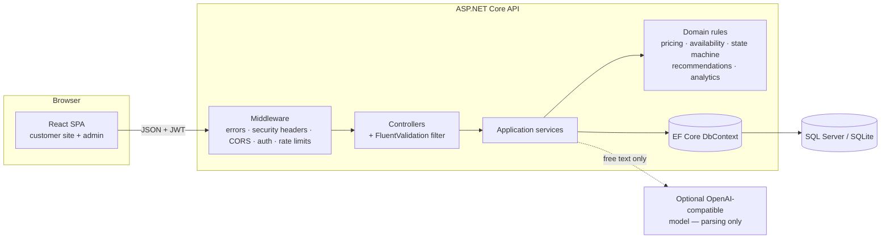
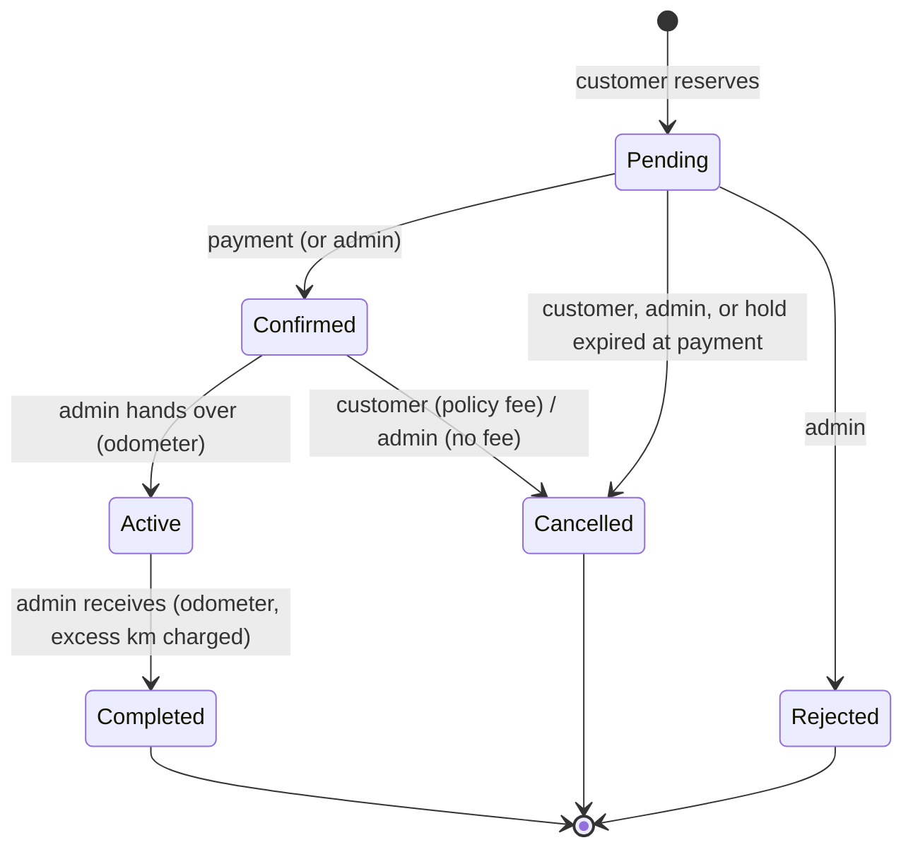

# Architecture

## Layers

| Project | Responsibility | Depends on |
|---|---|---|
| `SmartDrive.Domain` | Pure, side-effect-free rules: `PricingCalculator`, `AvailabilityRules`, `BookingStateMachine`, `CancellationPolicy`, `ReviewEligibility`, `RecommendationEngine`, `PreferenceParser`, `UtilisationCalculator`, `MaintenanceRules`, `DemandForecaster`, `SentimentAnalyzer`, `InsightGenerator`. Entities and enums. | nothing |
| `SmartDrive.Application` | Use cases as services (`BookingService`, `CatalogService`, `ReviewService`, `RecommendationService`, `AnalyticsService`, `FleetAdminService`, …), DTO contracts, the `SmartDriveDbContext` and its configuration, Identity user, seeding. | Domain, EF Core, Identity |
| `SmartDrive.Api` | HTTP: controllers, JWT issuing and validation, authorisation policies, validation, problem-details error mapping, OpenAPI, rate limiting, logging, static media. | Application |

Keeping the rules in the Domain project means the most important behaviour — prices, overlaps, transitions, scores — is unit-tested without a database or web server.

## Request flow: creating a booking

1. `POST /api/bookings` arrives with a JWT; the bearer handler validates it and `OnTokenValidated` reloads the user to confirm the account is still active and the roles are current.
2. The validation filter runs `CreateBookingRequestValidator` (shape only). Failures return `400` problem details with field errors.
3. `BookingService.CreateAsync` loads the vehicle and its blocking intervals, asks `AvailabilityRules` whether the window is free (confirmed and active bookings plus turnaround, unexpired holds, maintenance windows, vehicle status, lead time and maximum length), and asks `PricingCalculator` for the price. **The client never sends a price.**
4. The booking is saved as `Pending` with a 30-minute hold, and the vehicle's `BookingVersion` concurrency token is incremented in the same transaction. If another request booked the same car in the meantime, EF Core raises `DbUpdateConcurrencyException`, which becomes `409 Conflict`. A unit test fires eight simultaneous bookings at one car and asserts exactly one succeeds.
5. `POST /api/bookings/{ref}/pay` requires an `Idempotency-Key` header; repeating a key returns the original result instead of paying twice. Payment confirms the booking.

## Booking state machine

Every transition is recorded in `BookingStatusChanges` and the audit log; illegal transitions return `409`.

## Security

- **Authentication:** ASP.NET Core Identity stores users (PBKDF2 password hashes, lockout after 5 failures for 10 minutes). Login issues a signed JWT (`sub`, `role`, expiry). The signing key must be configured outside Development.
- **Authorisation:** customers can only see their own bookings (other references return `404`, not `403`, so they cannot be enumerated); `/api/admin/*` requires the `AdminOnly` policy. Admins cannot deactivate themselves or remove the last administrator.
- **Revocation:** deactivating an account takes effect on the next request even for unexpired tokens, because token validation re-checks the account.
- **Input:** FluentValidation on every request DTO; server-side business validation in services; CSV exports neutralise spreadsheet formula injection; uploads are checked by file signature and size, stored under generated names and served with a restrictive content-security policy.
- **Abuse:** rate limits on sign-in/registration, recommendations, payments and the contact form.
- **Errors:** a central `IExceptionHandler` maps domain errors to problem details and returns a generic message for anything unexpected, so stack traces never reach clients.
- **Headers:** `X-Content-Type-Options`, `X-Frame-Options: DENY`, `Referrer-Policy: no-referrer`, a restrictive `Permissions-Policy`, a sandboxing CSP on uploaded media, and HSTS outside Development.
- **Logging:** request logging records method, path, status and duration only — no bodies, tokens or personal data.
- **Secrets:** none are committed; see [setup](setup.md).

## Time and money

- Instants are stored in UTC and converted to South African Standard Time (UTC+2, no daylight saving) at the edges. The UI treats date-time inputs as SAST regardless of the browser's time zone.
- Amounts are `decimal` in Rand, VAT-inclusive, rounded to cents. SQLite stores them as doubles (it has no decimal type); SQL Server uses `decimal(18,2)`.

## Frontend

- One React app with two areas: the public/customer site and the lazily loaded admin dashboard. three.js and Recharts load only when the 3D viewer or admin area is opened.
- `src/api` holds typed endpoint wrappers over a single Axios client that adds the token and normalises problem details into `ApiError`.
- Forms use React Hook Form with Zod schemas that mirror the server rules; server field errors are mapped back onto the fields.
- Session tokens are kept in `localStorage` for simplicity; see [limitations](limitations.md).
