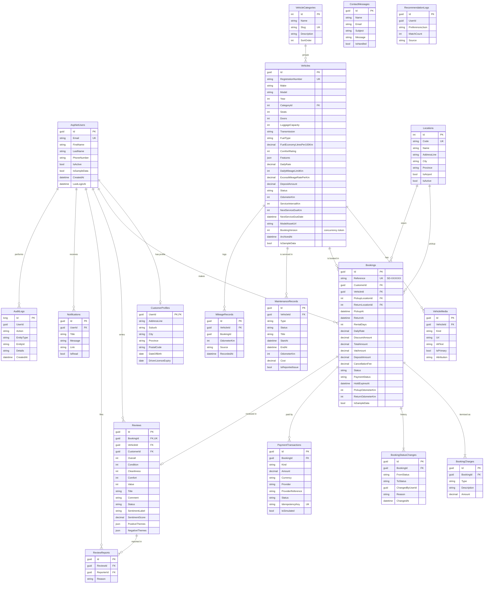

# Data model

The schema is normalised: reference data (categories, branches) is separate from vehicles; prices are copied onto each booking at the time it is made, with an itemised `BookingCharges` table, so later rate changes never rewrite history. Identity tables (`AspNetUsers`, `AspNetRoles`, …) hold accounts; the user's optional profile is a one-to-one `CustomerProfiles` row.

Every table that the seeder can populate has an `IsSampleData` flag so generated rows are always distinguishable from real ones.

## Notes

- **Enums are stored as strings** for readable data and safe reordering.
- **One review per booking** is enforced by a unique index on `Reviews.BookingId`; eligibility (completed rental, by the same customer, within 90 days) is enforced in the service.
- **Payment idempotency** is enforced by a unique index on `PaymentTransactions.IdempotencyKey`.
- **Double-booking protection** relies on `Vehicles.BookingVersion`, an optimistic concurrency token updated with every booking change for that vehicle.
- `RecommendationLogs` stores the preferences of a recommendation request (no personal data) for later tuning.
- Exact indexes and lengths are in `backend/src/SmartDrive.Application/Data/Configurations/EntityConfigurations.cs` and the generated migration.
